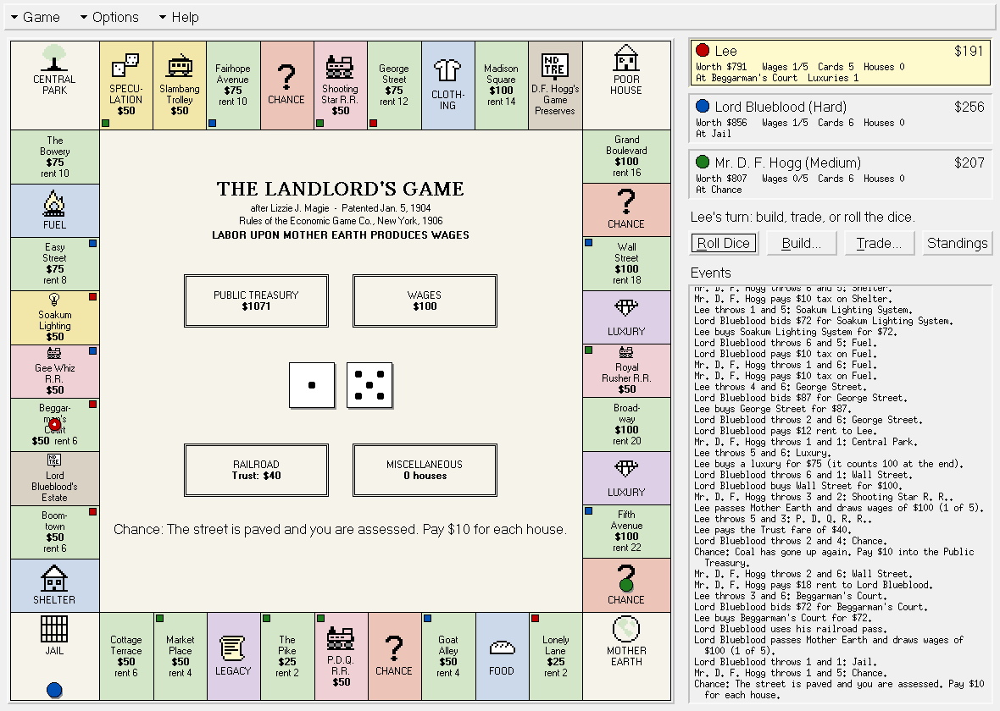
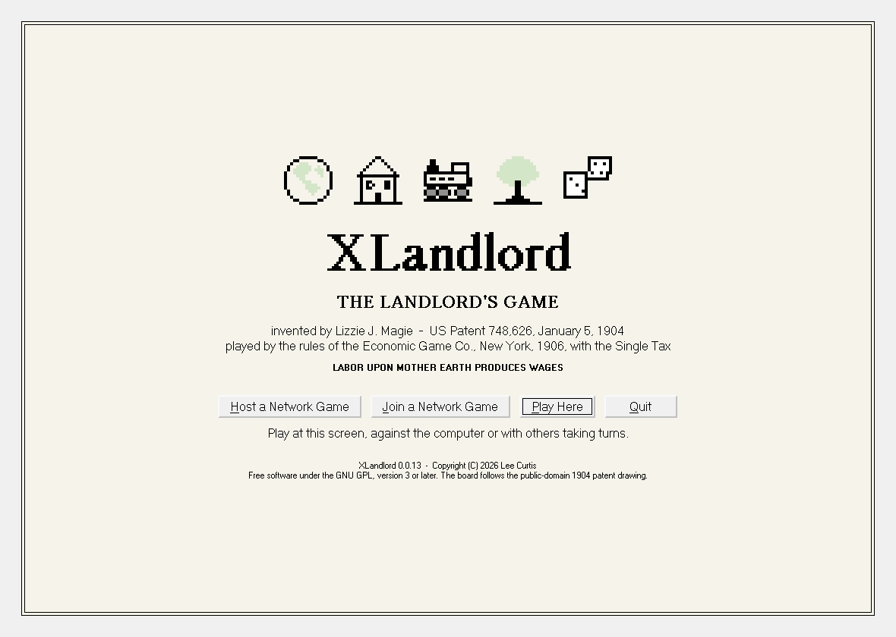
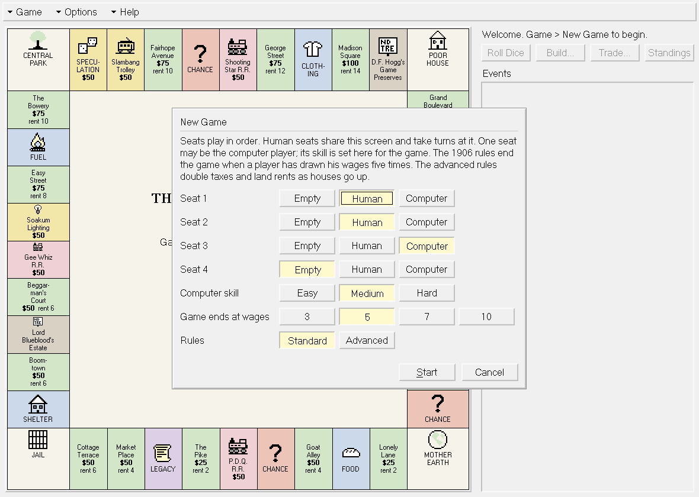
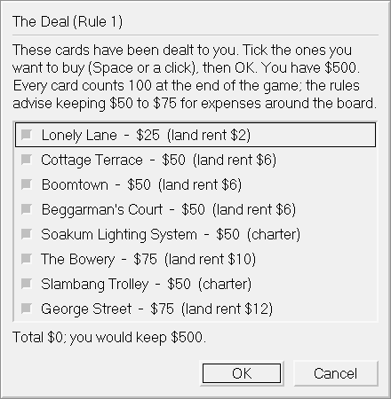
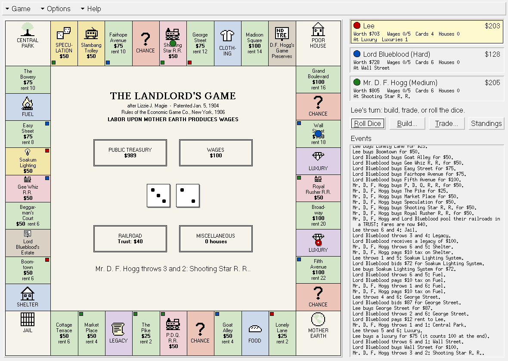
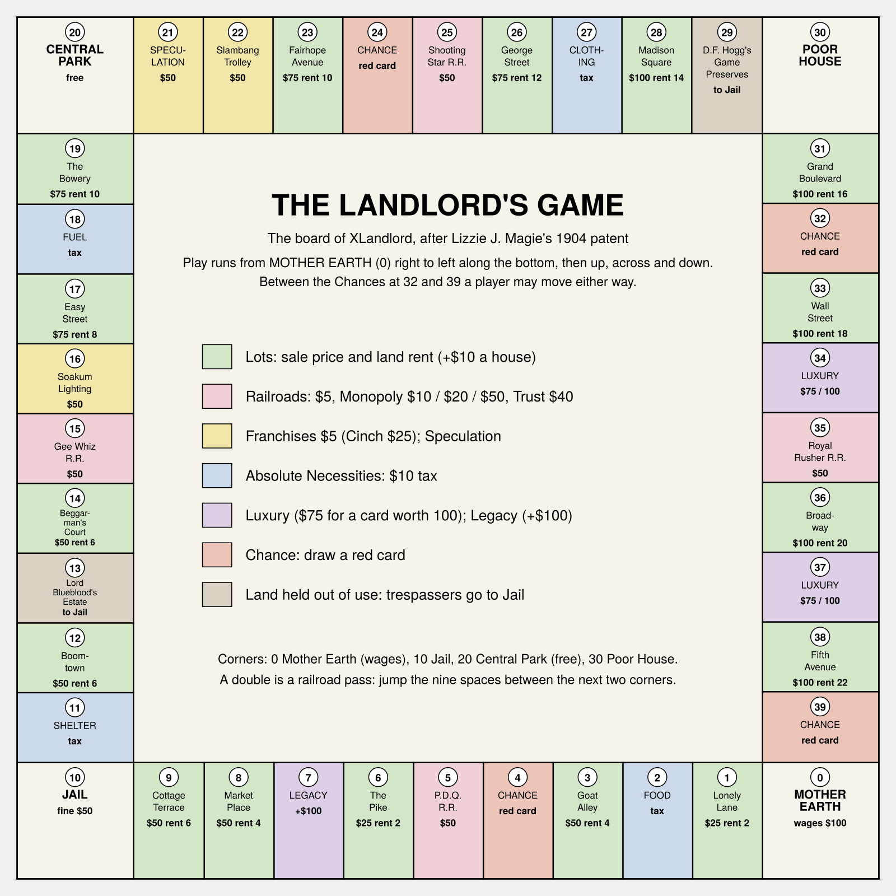
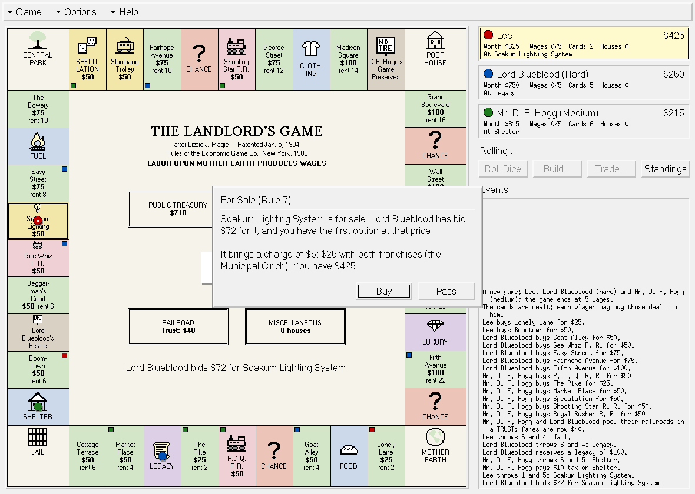
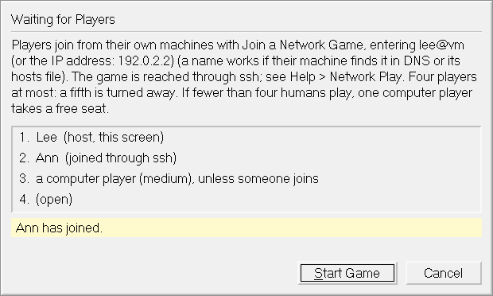
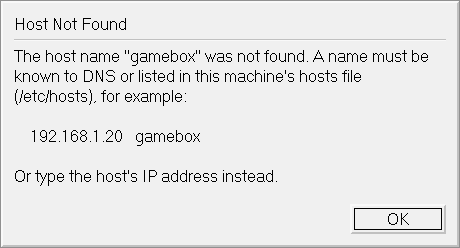
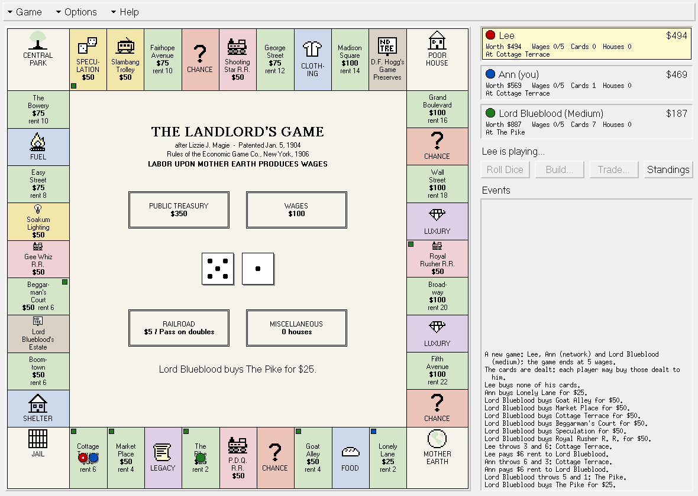

# The Landlord's Game: How to Play XLandlord

*Lizzie J. Magie's game of 1904, by the rules of 1906, with the Single Tax,
for one to four players at one screen or over the network.*

XLandlord 0.0.8. Copyright (C) 2026 Lee Curtis. This document is
part of the program and is free under the GNU General Public License,
version 3 or later; the rules it describes are those of the public-domain 1904
patent and 1906 rule book.

In the program, Help > How to Play (F1) gives the same guide in short, a
page at a time with screenshots, and `man 6 XLandlord` gives the rules
together with installation and setup.

## Contents

1. The game and its inventor
2. What you are trying to do
3. Starting a game
4. The deal
5. A turn
6. The board
7. Buying, bidding and rent
8. Railroads and franchises
9. Taxes, Chance, Luxury, Legacy and Speculation
10. Jail, the Poor House and raising money
11. Houses
12. Trading
13. The end of the game
14. The advanced and scientific rules
15. The Single Tax
16. The computer players
17. Several players at one screen
18. Playing over the network
19. Keys and mouse
20. What this edition had to decide
21. Sources
22. Quick reference

## 1. The game and its inventor

Elizabeth J. "Lizzie" Magie (1866-1948) of Macomb, Illinois, was a writer,
stenographer, actress and inventor, and a follower of the economist Henry
George. George argued that the rent of land is created by the whole community,
and that a single tax on land values should replace every other tax.

To show what George taught, Magie designed **The Landlord's Game**, tried it
out in the single-tax colony of Arden, Delaware, and patented it: US Patent
748,626, filed March 23, 1903 and granted January 5, 1904. Its board was a
continuous circuit, something new at the time, with lots for sale or rent,
railroads, franchises, taxes on the necessities of life, a Jail, a Poor House
and a corner marked *Labor upon Mother Earth Produces Wages*.

The Economic Game Company of New York published the game in 1906 with two sets
of rules. Under the ordinary rules one player ends up owning everything: in
Magie's words, "the land monopolist is monarch of the world." Under the
**Single Tax** rules the rent of land goes to the public, the utilities become
free, colleges are built and wages rise for everyone. She hoped that children
who played it would see the unfairness for themselves.

The game spread by hand among students and Quaker communities, who drew their
own boards. One of those boards reached Charles Darrow, whose version Parker
Brothers sold as *Monopoly* from 1935; the firm bought Magie's 1924 patent for
$500. Her part in the story was largely forgotten until the 1970s.

XLandlord plays the 1906 game, against the computer or against other
people, in a window drawn in the style of the Viola web browser of 1992.

## 2. What you are trying to do

Get as much wealth as you can. The game ends when one player has drawn his
wages a set number of times (five, by the 1906 rules), and the richest player
wins. Wealth is counted as:

- your **cash**, plus
- **100** for every **card** you hold (title deeds to lots, railroad and
  franchise charters, the broker's license), whatever you paid for it, plus
- **100** for every **house** you built, plus
- **100** for every **luxury** card, plus
- **100** for every **Professor** card (Single Tax only).

Because every card counts 100 at the end, a lot bought for $25 is worth $75 more
than the money you paid, before it collects a single rent.



## 3. Starting a game

When the program starts it asks how you want to play:



- **Host a Network Game**: you run the game and up to three players join
  from their own machines (section 18).
- **Join a Network Game**: you play in a game someone else is hosting
  (section 18).
- **Play Here**: you play at this screen, against the computer or with others
  taking turns. This opens the **New Game** form described below.

The same choices are in the Game menu at any time (Game > New Game is *Play
Here*; Ctrl+N). From a terminal, `XLandlord --host`, `--join HOST` or
`--local` skips the question.

The **New Game** form:



- **Seats 1 to 4.** Each seat is *Empty*, *Human*, *Easy*, *Medium* or *Hard*.
  Humans play at this screen and take turns at the keyboard; Easy, Medium and
  Hard are computer players. A table needs at least two players and at least
  one human. Seats play in order; empty seats are skipped.
- **Game ends at wages.** 3, 5 (the 1906 rule), 7 or 10.
- **Rules.** *Standard*, or *Advanced* (the "advanced and scientific" rules of
  section 14).

After **Start**, each human seat is asked for its player's name. Every player
starts with money according to the number of players, as the 1906 rules say:

| Players | Each starts with |
| ------- | ---------------- |
| 2       | $600             |
| 3       | $500             |
| 4       | $400             |

All checkers start on MOTHER EARTH.

## 4. The deal

*(Rule 1.)* The cards are shuffled and dealt round, one at a time, until 24
have been dealt or the pack is empty (there are 23 cards, so all of them are
dealt). Each player may buy any of the cards dealt to him at the sale price
printed on it; the money goes into the PUBLIC TREASURY. Cards not bought go back
into the pack, and can be bought later by stopping on their spaces.



Tick the cards you want with a click or the Space bar (A ticks all, N none) and
press OK. The line under the list shows what they cost and what you would keep.
The 1906 rules advise keeping $50 to $75 to pay your way round the board.

## 5. A turn

On your turn the status line says so and the **Roll Dice** button has the black
focus box. Before you throw you may build houses, buy or sell cards, or propose
the Single Tax (sections 11, 12, 15). Then press **Roll Dice** (Space, Enter or
R).

Two dice are thrown and your checker moves forward that many spaces. Three
things can change the move:

- **Between the Chances** *(Rule 2).* If your checker is on one of the spaces
  between the Chance at 32 and the Chance at 39 (Wall Street, the first
  Luxury, the Royal Rusher R.R., Broadway, the second Luxury, Fifth Avenue),
  you may move **backward** instead of forward. A dialog shows where each way
  would take you.

  

- **The railroad pass** *(Rule 17).* A double is an "official pass on the
  railroad": if your throw carries you past the next corner, you may jump the
  nine spaces between that corner and the following one, so you finish nine
  spaces further on. You may choose not to use it, if the square it leads to is
  worse.
- **Refusing to speculate** *(Rule 8).* If your throw would bring you onto
  SPECULATION, you may refuse to move and stay where you are.

**Wages** *(Rule 3).* Each time you reach or pass MOTHER EARTH you draw $100
wages (more under the Single Tax, once wages have been raised). Your box in the
panel counts how many times you have drawn them.

Then the space you stopped on is settled: the next sections say how. Several
players may stand on one space; each pays what it calls for.

## 6. The board

The board has 40 spaces: four corners and nine spaces on each side. Play runs
from MOTHER EARTH (space 0, bottom right) right to left along the bottom, up the
left side, across the top and down the right side. The four railroads stand in
the middle of the four sides.



The kinds of space:

| Space | What happens |
| ----- | ------------ |
| **Lot** (green) | For sale, or land rent to its owner (section 7). |
| **Railroad** (pink) | For sale, or a fare to its owner (section 8). |
| **Franchise** (yellow): Soakum Lighting System, Slambang Trolley | For sale, or a charge to its owner (section 8). |
| **Absolute Necessity** (blue): Food, Shelter, Fuel, Clothing | $10 tax into the Public Treasury. |
| **Lord Blueblood's Estate**, **D. F. Hogg's Game Preserves** | Land held out of use: you are trespassing and go to Jail. |
| **Chance** | Draw a red card and do what it says. |
| **Luxury** | Buy a luxury for $75, or move backward. |
| **Speculation** | The broker's game. |
| **Legacy** | Receive $100. |
| **Mother Earth** | Wages when you reach or pass it. |
| **Jail** | Where trespassers go (stopping there is only a visit). |
| **Central Park** | Maintained by public funds: free. |
| **Poor House** | Where those who cannot pay go (stopping there is a visit). |

Click any space on the board to read about it, its owner and its rent.

The lots, their prices and their land rents:

| No. | Lot | Price | Land rent |
| --: | --- | ----: | --------: |
| 1 | Lonely Lane | $25 | $2 |
| 3 | Goat Alley | $50 | $4 |
| 6 | The Pike | $25 | $2 |
| 8 | Market Place | $50 | $4 |
| 9 | Cottage Terrace | $50 | $6 |
| 12 | Boomtown | $50 | $6 |
| 14 | Beggarman's Court | $50 | $6 |
| 17 | Easy Street | $75 | $8 |
| 19 | The Bowery | $75 | $10 |
| 23 | Fairhope Avenue | $75 | $10 |
| 26 | George Street | $75 | $12 |
| 28 | Madison Square | $100 | $14 |
| 31 | Grand Boulevard | $100 | $16 |
| 33 | Wall Street | $100 | $18 |
| 36 | Broadway | $100 | $20 |
| 38 | Fifth Avenue | $100 | $22 |

The other cards cost $50 each: the four railroads (P.D.Q. R.R. at 5, Gee Whiz
R.R. at 15, Shooting Star R.R. at 25, Royal Rusher R.R. at 35), the two
franchises (Soakum Lighting System at 16, Slambang Trolley at 22) and the
broker's license (Speculation, at 21).

## 7. Buying, bidding and rent

*(Rule 7.)* When you stop on a lot, railroad or franchise:

- **If you own it**, nothing happens.
- **If another player owns it**, you pay him: the land rent of a lot (plus $10
  for each house on it), or the fare or charge of a railroad or franchise.
- **If nobody owns it**, it is for sale at its price, and the other players may
  **bid** more than the price.



The bidding runs like a real auction in $5 steps among the other players: the
highest bidder's bid is $5 more than the runner-up's limit (never more than his
own limit). **You have the first option**: you may buy at the highest price bid
(or at the price, if nobody bid). If you do not buy:

- and somebody bid, he buys it at his bid, and you pay him the rent or fare at
  once;
- and nobody bid, nobody buys it, and you pay its land rent (or $5 for a
  railroad or franchise) into the Public Treasury.

When another player stops on an unowned card, the program asks you for the most
you will bid (enter 0 for no bid). If you would rather not be asked, turn off
Options > Ask Me to Bid.

## 8. Railroads and franchises

*(Rule 9.)* The railroads and the two franchises are public utilities in
private hands.

| What you own | Each stop by another player pays you |
| ------------ | ------------------------------------ |
| one railroad | $5 |
| two railroads (MONOPOLY) | $10 on each of them |
| three railroads | $20 on each |
| all four railroads | $50 on each |
| one franchise | $5 |
| both franchises (the MUNICIPAL CINCH) | $25 on each |

**The Trust.** If two players own all four railroads between them, they may
pool them in a TRUST: every railroad fare becomes **$40**, and the two partners
divide the profits (and ride free on each other's lines). Both are asked when
it becomes possible; a trust breaks up when a railroad changes hands.

## 9. Taxes, Chance, Luxury, Legacy and Speculation

**Absolute Necessities** *(Rule 4).* Food, Shelter, Fuel and Clothing each
charge **$10** tax, paid into the Public Treasury (this is "indirect
taxation"). The advanced rules raise it (section 14); the Single Tax abolishes
it.

**Chance** *(Rule 11).* Draw a card from the red pack; it goes back into the
pack afterwards. The sixteen cards:

| The card says | Effect |
| ------------- | ------ |
| Coal has gone up again. | pay $10 |
| Found a purse on Broadway. | collect $25 |
| A rich uncle remembers you. | collect $100 |
| Caught gathering firewood on Lord Blueblood's Estate. | go to Jail |
| Go back to Mother Earth and collect your wages. | move to Mother Earth (wages) |
| Take a trip on the next railroad and pay the fare. | move to the next railroad and settle it |
| The doctor's bill comes due. | pay $25 |
| You sell a painting at the fair. | collect $50 |
| The street is paved and you are assessed. | pay $10 for each house you own |
| You forgot your umbrella. | go back three spaces |
| A tip on the stock market goes wrong. | pay $50 |
| Elected to the Board of Aldermen. | every other player pays you $10 |
| A holiday! Take a stroll to Central Park. | move to Central Park |
| The new trolley line raises land values. | collect $5 for each lot you own |
| You give a dinner for your friends. | pay every other player $10 |
| Your work is praised and your wages raised. | collect $30 |

Money paid on a Chance card goes into the Public Treasury; a move forward past
Mother Earth draws wages.

**Luxury** *(Rule 13).* Pay **$75** for a luxury card, which counts **100** at
the end. If you will not (or cannot) pay, you move **backward** from the space
you started the throw on, as far as you threw, and settle that space instead.

**Legacy.** Receive **$100**.

**Speculation** *(Rule 8).* Unless you refuse to move onto it (section 5):

1. If nobody holds the broker's license, it is offered for sale like a lot.
2. You pay a **$10 ante** to the broker (the license holder; to the bank if
   there is none; nothing if you are the broker).
3. You throw the dice again:

| You throw | You win |
| --------- | ------- |
| any double | $100 |
| 11 | $90 |
| 10 | $80 |
| 9 | $70 |
| 8 | $60 |
| 7 | $50 |
| 6 | $40 |
| 5 | $30 |
| 3 or 4 (not a double) | nothing: a "skin game" |

The broker takes **10%** of your winnings. On a skin game the broker is caught:
he goes to Jail and his license goes back to the pack. On average the
speculator comes out well ahead of his ante.

## 10. Jail, the Poor House and raising money

**Jail** *(Rules 5 and 6).* Stopping on Lord Blueblood's Estate or D. F.
Hogg's Game Preserves, or drawing the Chance card that says so, sends you
straight to Jail; your turn ends. On each later turn you either:

- **pay the $50 fine** into the Public Treasury, then throw and move as usual;
  or
- **throw for a double** ("serving your time"): a double lets you out and you
  move by that throw; anything else keeps you in Jail.

You cannot miss more than three turns if you can raise the fine: on the third
turn the fine is paid for you. You leave Jail counting from Shelter, the space
in front of it. Stopping on the Jail space by an ordinary move is only a visit.

**Raising money.** When you owe more than you have, you must raise the
difference by selling:

- a card to a computer player, at the offer he makes;
- a card back to the pack, for **half its sale price**;
- a house back to the bank, for **$50**.

A lot with houses on it must have its houses sold first. A dialog lists what you
can sell and what each brings.

**The Poor House** *(Rule 12).* If you cannot pay and have nothing left to sell
(or you choose to give up), you pay what you have and go to the Poor House.
You stay there until your next turn, then throw and move out as usual.

## 11. Houses

*(Rule 14.)* In your turn, before you throw, you may build houses on your own
lots (Game > Build a House, or B). A house costs **$100**; each house adds
**$10** to the rent of its lot, and every house counts **100** at the end.
There may be up to nine houses on a lot under the standard rules, three under
the advanced rules.

## 12. Trading

*(Rule 16 and the 1906 "Suggestions".)* All cards may be bought, sold and
traded between players. Before you throw:

- **Buy a Card from a Player** (T): choose a card another player holds and
  name your offer. A computer player accepts if your offer beats what the
  card is worth to it; a human is asked to accept or decline.
- **Sell a Card to a Player** (S): choose one of your cards; the list shows
  each computer player's offer, and lets you name a price to any human, who is
  asked to accept or decline.
- **Sell to the Pack**: cards back to the pack at half price, houses to the
  bank for $50, or a card to a computer player at his offer.

Lots with houses cannot change hands until the houses are sold. Under the
Single Tax, title deeds to lots are worth nothing and cannot be traded.

## 13. The end of the game

*(Rule 19.)* The game ends at the end of the turn in which a player draws his
wages for the last time (five times, or the number chosen). The final
standings are shown: each player's cash, cards, houses, luxuries and worth,
richest first. The richest player is the winner, "the millionaire". Game >
Standings (F2) shows the same table at any time.

## 14. The advanced and scientific rules

Choose *Advanced* in the New Game form for the 1906 rules "for advanced and
scientific players", which bring the game to a decision sooner:

- **Taxes rise with building.** When 10 houses stand on the board the tax on
  each Absolute Necessity is **$20**; at 25 houses it is **$40**.
- **Land rents double in improved sections.** The corners and the railroads
  divide the board into eight sections of four spaces. When every lot in a
  section has at least one house, the land rent of every lot there doubles;
  when every lot has two houses it doubles again; at three, again (so the base
  rent is multiplied by 2, 4 or 8). House rent stays $10 a house.
- **Three houses at most** on any lot.

## 15. The Single Tax

The 1906 rules let the players "prove how the application of the Single Tax
would benefit everybody by equalizing opportunities and raising wages" at any
time, "by a vote of at least two of the players". In your turn, choose Game >
Propose the Single Tax (X). Every other player votes; your vote and one more
put it in force. The computer players propose it too, when it would help them.

Under the Single Tax, players keep what they hold, except that **title deeds to
lots are worth nothing**, and:

1. **No taxes** on the Absolute Necessities.
2. **All land rent goes into the Public Treasury**, which starts empty.
3. Railroad fares and franchise charges are still paid to their owners, until
   the public takes them over (below); then they are free.
4. When you stop on a lot you pay its land rent into the Treasury; if another
   player has built on it, you also pay him **$10 for each house**. If the lot
   is unimproved you may build a house on it for $100 and collect its house
   rent from then on.
5. Lord Blueblood's Estate and Hogg's Game Preserves are reserved for free
   colleges; until they are built, trespassers still go to Jail.
6. **Every $50 in the Public Treasury is spent for the public**, in this order:
   - buying **Soakum Lighting System** from its owner for $50; it becomes free;
   - then **Slambang Trolley**;
   - then the railroads, **P.D.Q.**, **Gee Whiz**, **Shooting Star**, **Royal
     Rusher**;
   - then a **free college on Lord Blueblood's Estate**, then one on
     **Hogg's Game Preserves** (no more Jail for stopping there);
   - then **wages rise by $10** for every further $50.
7. Stopping at a free college gives an **Education** card; four Education cards
   are exchanged for a **Professor** card, which counts 100 at the end.
8. There is **no Poor House**: a player who cannot pay rests on the Natural
   Opportunity (the corner) behind him, and before his next throw draws $50
   wages from it.

The center of the board says THE SINGLE TAX IS IN FORCE, and its boxes show
the Treasury and the wages.

## 16. The computer players

| Level | How it plays |
| ----- | ------------ |
| **Easy** | On impulse: buys about half of what it can afford, seldom bids or builds, chooses its moves at random, keeps little cash in hand. |
| **Medium** | By rules of thumb: buys and builds while keeping $100 in hand, bids a little over the price for good cards, pays out of Jail early in the game, avoids an obviously dear square when it has a choice. |
| **Hard** | By counting: values each card at 100 plus the rent it should bring in the circuits left, keeps in hand what a trip round the board is likely to cost, goes after railroad monopolies and the Municipal Cinch and blocks yours, bids up to a card's worth, stays in Jail late in the game when the board is dangerous, picks the cheaper square for a pass or a backward move, trades with the other computer players, and votes on the Single Tax by what it does to its standing. |

In the program's own tests (hundreds of games between computer players) Hard
beats Easy about 96 times in 100, Medium beats Easy about 86, and Hard beats
Medium about 59: the dice still have their say.

Options > Computer Speed sets how long the program pauses after each computer
move (any key hurries it along); Options > Confirm Each Computer Move waits for
a key instead.

## 17. Several players at one screen

Set two or more seats to *Human* in the New Game form. The players take turns
at the keyboard and mouse:

- when the turn passes from one human to another, a **Pass the game to ...**
  prompt says whose turn it is;
- every question names the player it is for, such as "Ann: For Sale (Rule 7)",
  because some come on other players' turns: bids, Single Tax votes, the Trust,
  money owed;
- humans can trade with each other (section 12).

## 18. Playing over the network

Up to four players can play from their own machines. One **hosts** the game;
the others **join** it through **ssh**.

**To host:** Game > Host a Network Game. Choose the computer player's strength,
the length of the game, the rules, and a port (1904 unless that is taken). The
waiting room shows who has joined; press **Start Game** when everyone is in.



The waiting room also shows how to reach the host: its name and its IP
addresses.

**Who is where.** Next to each player's name the game shows the machine he
plays from: the host's own host name, and for each joiner the name of the
machine his ssh connection came from. The host finds that name the same way
it finds every name, in its hosts file and in DNS; a machine it has no name
for is shown by its IP address (*Bea (from 203.0.113.45)*). The same labels
appear in the joiners' waiting room and, once the game starts, in the player
boxes: *Lee (host, gamebox)*, *Ann (you, annbox)*, *Bea (network,
203.0.113.45)*. A long name is shortened with "..." to fit.

**To join:** Join a Network Game (at start-up, or in the Game menu), and type
the host's address. You see the same board and the same dialogs, and on your
turn the buttons work.

**Giving the host's address.** Type the host's **IP address** (IPv4 such as
`192.168.1.20`, or IPv6 such as `2001:db8::5`) or its **host name** (such as
`gamebox` or `gamebox.example.org`). A name is looked up the way the system
looks up every name: in the machine's **hosts file** (`/etc/hosts`) and in
**DNS**, in the order `/etc/nsswitch.conf` gives. If the name is in neither, the
game says so (*Host Not Found*) before trying ssh, and you can type the IP
address instead or add a line such as

```
192.168.1.20   gamebox
```

to `/etc/hosts` (as root). Add `user@` in front to log in to the host as
another user, and `:port` after it if the host chose another port than 1904;
for an IPv6 address with a port, put the address in brackets:
`lee@[2001:db8::5]:1905`. ssh is given the name as you typed it, so its
`known_hosts` entry for that name keeps working.





**The table.** Four players at most: the host and three joiners. A fifth
player is turned away with a warning, and so is anyone joining a game already
under way. When fewer than four humans sit down, **one** computer player takes
a free seat; four humans play without one. If a joiner's connection drops, a
computer player of medium strength takes over his seat and the game goes on;
if the host leaves, the game ends for everyone.

**What you need.** The same version of the game on every machine, an ssh
server on the host, and **password-less ssh** from each joiner to the host. On
each joiner's machine:

```
ssh-keygen -t ed25519          # once, if you have no key
ssh-copy-id user@host          # puts the key on the host
ssh -o BatchMode=yes user@host XLandlord --version
```

The last command must print the version without asking anything. README.md and
INSTALL.md cover what to do when it does not. The game never opens a port to
the network: the host listens on its own machine only, and each joiner's
connection runs inside ssh.

## 19. Keys and mouse

| Key | Does |
| --- | ---- |
| Space, Enter, R | roll the dice (on your turn) |
| B | build a house |
| T | buy a card from another player |
| S | sell a card to another player |
| X | propose the Single Tax |
| F1 | how to play: the illustrated guide |
| F2 | the standings |
| Page Up, Page Down, End | scroll the record of events; End returns to the newest |
| Esc, F9, F10 | the menu bar; Alt+G, Alt+O, Alt+H open a menu |
| Ctrl+N | new game |
| Ctrl+Q | quit |

From a terminal: `XLandlord --host` hosts a network game,
`XLandlord --join HOST` joins one (HOST as in section 18),
`XLandlord --local` plays at this screen; with none of them the game asks.

In dialogs, Enter presses the button with the black focus box; Tab and the
arrow keys move it; Esc backs out; an underlined letter presses its button; in
lists Space ticks a box and a double click chooses. Click a space on the board
to read about it; the mouse wheel scrolls lists and the record of events.

## 20. What this edition had to decide

The surviving 1906 rule text does not give everything, and its Rule 18 leaves
emergencies "to be settled among the players". This edition settles them so:

- **The order of the spaces.** The rules fix some positions: The Pike is the
  6th space, Beggarman's Court the 14th, Shelter is in front of the Jail, and
  Luxury is six spaces past Madison Square, which is six past Slambang
  Trolley. The railroads divide each side, and nine spaces lie between corners.
  The other spaces are placed around those, cheap lots near Mother Earth.
- **Land rents** follow the 1906 rent table, which runs from $2 to $22 in steps
  of $2, in order round the board.
- **The Legacy space** (from the 1904 patent) and a second Luxury fill the
  40 spaces.
- **The Chance cards** of 1906 have not survived in print; the sixteen here are
  new, written in the spirit of the game.
- **Raising money**: no borrowing between players; cards may be sold to the
  pack at half price and houses to the bank for $50.
- **Bidding** runs in $5 steps, the winner paying $5 over the runner-up.
- **Houses**: nine at most on a lot under the standard rules.
- **Single Tax Rule 8**: the Natural Opportunity pays $50.

## 21. Sources

- US Patent 748,626, *Game-Board*, Lizzie J. Magie, January 5, 1904 (public
  domain).
- US Patent 1,509,312, *Game Board*, Elizabeth Magie Phillips, September 23,
  1924.
- *The Landlord's Game* rules, Economic Game Co., New York, 1906, as transcribed
  at landlordsgame.info (Thomas Forsyth).
- Wikipedia: "The Landlord's Game"; "Elizabeth Magie".
- The Public Domain Review: "The Landlord's Game".
- Mary Pilon, *The Monopolists* (2015).

## 22. Quick reference

**Start:** 2 players $600 each, 3 players $500, 4 players $400. The cards are
dealt; buy those you want. **Wages:** $100 each time you reach or pass Mother
Earth. **End:** when someone has drawn his wages 5 times (or the number
chosen). **Worth:** cash + 100 for each card, house, luxury and Professor card.

| Stop on | You |
| ------------------------- | ---------------------------------------------- |
| an unowned card | may buy it at its price (others may bid more; you have the first option); otherwise pay its rent, or $5, to the Treasury |
| another player's lot | pay the land rent + $10 a house |
| another player's railroad | pay $5; $10 / $20 / $50 if he owns 2 / 3 / 4; $40 in a Trust |
| another player's franchise | pay $5; $25 if he owns both (Municipal Cinch) |
| Food, Shelter, Fuel, Clothing | pay $10 tax ($20 at 10 houses, $40 at 25, advanced rules; none under the Single Tax) |
| Blueblood's Estate, Hogg's Preserves | go to Jail (a free college under the Single Tax, once built) |
| Chance | draw a red card |
| Luxury | pay $75 for a card worth 100, or move backward |
| Speculation | ante $10; throw: double $100, 11 $90 ... 5 $30, 3 or 4 nothing |
| Legacy | receive $100 |
| Central Park, Jail (visiting), Poor House (visiting) | nothing |

| Rule | In short |
| ------------------------- | ---------------------------------------------- |
| Jail | $50 fine, or a double; at most three turns |
| Double | a railroad pass: skip the nine spaces between the next two corners |
| Between the Chances (32-39) | you may move backward |
| Houses | $100 each, +$10 rent each; 9 a lot (3 advanced) |
| Raising money | to the pack at half price; houses $50; to a computer player at his offer |
| Poor House | when you cannot pay at all; until your next turn |
| Single Tax | 2 votes; land rent to the Treasury; each $50 frees a utility, then builds a college, then raises wages $10 |

| Key | | Key | |
| --- | --- | --- | --- |
| Space | roll | F1 | help |
| B | build | F2 | standings |
| T / S | buy / sell a card | Esc | menus |
| X | Single Tax | Ctrl+N / Ctrl+Q | new game / quit |
